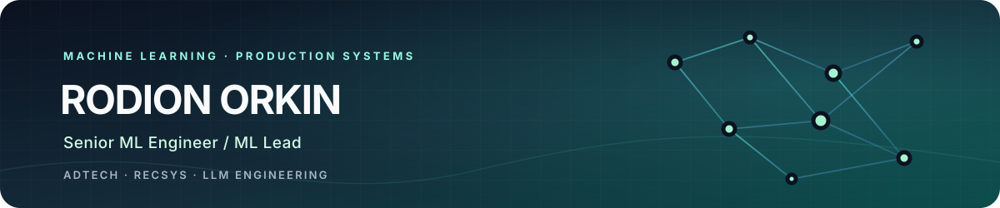

  

  
  
  

  Building production ML systems — from data and modeling to experimentation, serving, and monitoring.

---

## 🎯 Selected impact

<table>
  <tr>
    <td width="50%" align="center" valign="middle">
      <h2>−20–25%</h2>
      <strong>CPA reduction</strong> 
      100+ advertisers · online A/B tests
    </td>
    <td width="50%" align="center" valign="middle">
      <h2>+9%</h2>
      <strong>Recommendation CTR</strong> 
      +2.3% revenue per session
    </td>
  </tr>
  <tr>
    <td width="50%" align="center" valign="middle">
      <h2>611K</h2>
      <strong>Products relabeled</strong> 
      Fine-tuned LLM · production catalog
    </td>
    <td width="50%" align="center" valign="middle">
      <h2>10K+</h2>
      <strong>Fuddy downloads</strong> 
      Independent product · paid subscriptions
    </td>
  </tr>
</table>

## 🧭 What I build

<table>
  <tr>
    <td width="33%" valign="top">
      <h3>🎯 AdTech</h3>
      Purchase propensity · conversion modeling · bid optimization · calibration · offline conversions
        
      <strong>Impact:</strong> CPA −20–25% across 100+ advertisers
    </td>
    <td width="33%" valign="top">
      <h3>🧠 RecSys</h3>
      Candidate generation · ranking · personalization · cold start · low-latency serving
        
      <strong>Impact:</strong> CTR +9% in an online A/B test
    </td>
    <td width="33%" valign="top">
      <h3>🤖 LLM Engineering</h3>
      SFT / QLoRA · evaluation · distillation · inference · acceptance gates
        
      <strong>Impact:</strong> fine-tuned models shipped to production
    </td>
  </tr>
</table>

## 🏢 Experience

### RivoxAI · Machine Learning Engineer / ML function owner

Mar 2025 — Present · AdTech · AI bid optimization for Yandex Direct

- Built the ML function from scratch and owned its lifecycle: hypothesis backlog, data and training pipelines, deployment, online experiments, and monitoring. Coordinated a junior MLE and a senior data analyst.
- Developed purchase-propensity models for **100+ advertisers**. Reduced **CPA by 20–25% without reducing lead volume** in 4–6-week online A/B tests; designed a cold-start path for clients with fewer than 30 conversions.
- Engineered **~600 features** from **~5M clickstream events/day**. Improved CatBoost PR-AUC from **0.35 to 0.42** at ~1% purchase prevalence (ROC-AUC 0.90); increased auto-bidding signals **2–5×** through calibrated virtual conversions and offline-conversion uploads.
- Introduced weekly retraining and production monitoring, detecting **10+ tracking failures** before they wasted advertising spend.

Python · SQL · Polars · CatBoost · PyTorch · Optuna · MLflow · Docker · GCP · Yandex Metrica API

### CognitiveWave · Data Scientist / Recommender Systems

Sep 2023 — Feb 2025 · B2B e-commerce · catalogs up to ~500K SKUs

- Built a multi-tenant, two-stage recommender: ALS and two-tower candidate generation with Faiss HNSW retrieval, followed by LightGBM ranking. Improved NDCG@10 **0.21 → 0.24** and Recall@100 **0.34 → 0.40**; SASRec signals raised NDCG@10 to **0.26** for active users.
- Delivered **+9% CTR** and **+2.3% revenue per session** (*p* < 0.01) in a four-week online A/B test for a fashion retailer with ~2M MAU.
- Improved new-item cold start with multilingual-e5 embeddings (**Recall@100 0.06 → 0.17**) and served recommendations at **P99 < 50 ms** using Redis precomputation and FastAPI re-ranking.

Python · PyTorch · implicit · LightGBM · Faiss · Redis · FastAPI · Docker

## 🚀 Founder project · Fuddy

**Founder & ML Engineer · solo project** · [fuddy.team](https://fuddy.team) · 2026 — Present

A consumer product scanner for food and cosmetics. **10K+ downloads · paid subscriptions.** I lead product and ML engineering end to end.

- Fine-tuned **Qwen3-14B with QLoRA** on 230K labeled products, replacing a Qwen3-235B-A22B API dependency for nutrient and NOVA estimation; relabeled the full **611K-product** catalog and shipped it to production.
- Built acceptance gates across **~20 quality dimensions**. Traced a TRL / bf16 LoRA issue that rounded **74–96% of LoRA updates to zero**; added write-guards, reducing false-zero salt predictions from **309 to 8** in a 9.5K-product shadow evaluation.
- In a separate benchmark, an 8B prototype reached **92.7% NOVA accuracy vs. 70.0%** for Qwen3-235B-A22B (*n* = 327), with valid JSON improving from **90% to 100%**.

Python · PyTorch · Unsloth · TRL · QLoRA · bitsandbytes · vLLM · OCR · TypeScript · Next.js

## 🧰 Core technologies

  

| Area | Tools & methods |
|---|---|
| **ML & experimentation** | CatBoost, LightGBM, XGBoost, Optuna, feature engineering, probability calibration, A/B testing, bootstrap CIs |
| **Recommender systems** | ALS, two-tower, SASRec, GRU, Faiss, node2vec, candidate generation, ranking, cold start |
| **LLM engineering** | SFT, QLoRA, Unsloth, TRL, bitsandbytes, vLLM, model evaluation, distillation, embeddings, OCR |
| **Data & production** | Polars, pandas, FastAPI, Redis, Docker, Airflow, MLflow, Vertex AI, Cloud SQL, Grafana |

## 🎓 Education & recognition

<table>
  <tr>
    <td width="60%" valign="top">
      <strong>ITMO University · AI Talent Hub</strong> 
      MSc in Artificial Intelligence · in progress  
      <strong>NUST MISIS</strong> 
      BSc in Applied Mathematics
    </td>
    <td width="40%" valign="top">
      🥇 <strong>1st place</strong> · TechFriend AI Hack  
      🥉 <strong>3rd place</strong> · PSB.Hack, HSE University
    </td>
  </tr>
</table>

Additional training: Yandex School of Data Analysis · NLP | Deep Learning School, MIPT · CV / NLP

---

  <strong>Russian</strong> — Native &nbsp;·&nbsp; <strong>English</strong> — C1
    
  <a href="https://t.me/bizarreman">Telegram</a> &nbsp;·&nbsp;
  <a href="mailto:rodion.ork@yandex.ru">Email</a> &nbsp;·&nbsp;
  <a href="https://fuddy.team">Fuddy</a>

